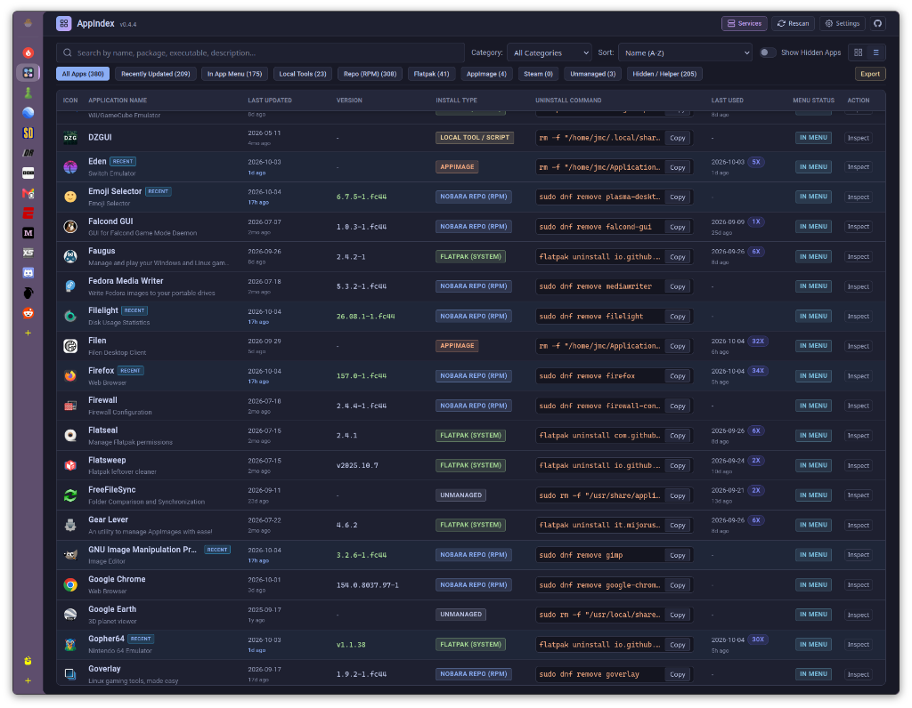
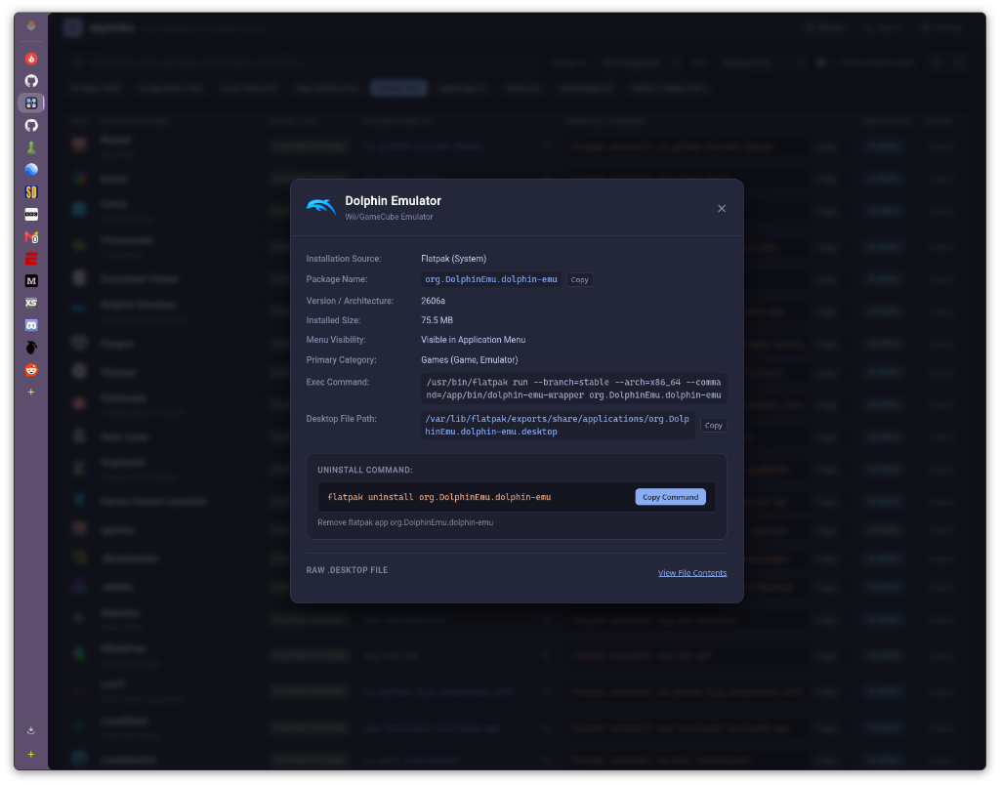

# AppIndex

Universal Linux Application & Package Inventory Inspector

AppIndex is a lightweight, local web dashboard and system inspector that inventories all applications installed across your Linux system. It automatically discovers, classifies, and manages applications across diverse packaging ecosystems, attributing each application to its underlying package manager or installation source, displaying exact package identifiers, highlighting newly installed and updated versions with transition tracking, and providing one-click copyable uninstall commands.

AppIndex detects software that has been **recently installed or upgraded on your host system** (it does not query remote repositories for uninstalled upstream updates):

- **When Checks Occur**:
  - **Service Startup**: Performs an initial system inventory when the AppIndex background service starts.
  - **Dashboard Load**: Loads the cached inventory upon opening the web UI, scanning if the cache is empty.
  - **Manual Rescan**: Clicking the **Rescan** button in the dashboard (or running `appindex scan`) forces an immediate, fresh scan across all package managers.

---

### Table View


### Card Grid View


### Application Inspector


### Customizable Export


---

## Supported Package Formats & Sources

AppIndex automatically scans and classifies applications from across all major Linux distribution channels:

### 1. Flatpaks (System & User)
- Discovers Flatpak packages from both System (`/var/lib/flatpak`) and User (`~/.local/share/flatpak`) scopes.
- Cross-references exports with `flatpak list` to extract application IDs, branch versions (e.g. `stable`), and installed disk footprints.
- Generates exact removal commands: `flatpak uninstall <app_id>` or `flatpak uninstall --user <app_id>`.

### 2. AppImages
- Detects standalone AppImage binaries located in standard directories like `~/Applications` or invoked from custom desktop files.
- Automatically discovers unindexed executable binaries placed in `~/Applications` and creates inventory records.
- Provides direct removal commands that clean up both the portable binary and any associated menu entries.

### 3. Native Distribution Repositories
AppIndex automatically detects your host distribution via `/etc/os-release` and queries the appropriate native package manager database:
- **Fedora / Nobara / RHEL / CentOS (RPM & DNF)**: Queries the native RPM database via Python bindings or `rpm -qf` to retrieve package names, versions, architectures, and install sizes, generating `sudo dnf remove <package>`.
- **openSUSE / SUSE (RPM & Zypper)**: Identifies RPM-managed packages on openSUSE systems, generating `sudo zypper rm <package>`.
- **Arch Linux / Manjaro / EndeavourOS (Pacman)**: Queries file ownership via `pacman -Qo` to resolve package identities and versions, generating `sudo pacman -R <package>`.
- **Debian / Ubuntu / Linux Mint / Pop!_OS (APT & DPKG)**: Queries `dpkg -S` and `dpkg-query` to resolve owning Debian packages and install sizes, generating `sudo apt remove <package>`.

### 4. Steam Games & Proton Titles
- Parses Steam application desktop entries (`steam://rungameid/<id>`).
- Extracts game IDs and provides native Steam uninstall triggers (`steam steam://uninstall/<id>`).

### 5. Progressive Web Apps (PWAs)
- Detects website shortcuts and Progressive Web Apps launched via Google Chrome, Brave, Microsoft Edge, and Mozilla Firefox (`--app=`, `--app-id=`, WebApp entries).
- Provides one-click commands to remove obsolete web shortcuts.

### 6. Local User Tools & Scripts
- Indexes custom scripts and internal utilities registered in `~/.local/share/applications/`.
- Accurately identifies user overrides that customize system or Flatpak applications, linking them back to the underlying package while noting the local customization.

### 7. Unmanaged
- Catches compiled software (`make install`), manual extractions in `/opt` or `/usr/local`, and standalone binaries not registered with any system package manager.

---

## Key Features

- **Freedesktop XDG Specification Compliance**
- **Dynamic Desktop Environment Detection**
- **Application Launch Frequency & Last Used Tracking**
- **Recent Update & Version Transition Tracking**
- **Anchored Header & Table Controls**
- **Dual Presentation**
- **Helper & Daemon Filtering**
- **Desktop Menu Category & Multi-Category Detection**: Resolves active desktop menu categories directly from the desktop environment menu layout (e.g. KDE Plasma kmenuedit and XDG menu definitions), highlighting applications placed across multiple menu categories (+N badge) to easily spot duplicate shortcuts.
- **Real-Time Search & Category Filters**: Instant fuzzy search across applications, packages, comments, and commands, with dedicated category and multi-category filters.
- **Theme & Appearance Engine**
- **Export Formats**

---

## Requirements

- Python 3.9+
- Linux (compatible with any distribution: Fedora, Nobara, Arch Linux, Ubuntu, Debian, openSUSE, etc.)
- Python packages:
  - `fastapi`
  - `uvicorn`
  - `pyxdg`
  - `rpm` (optional, for accelerated RPM queries on RPM-based distributions)

---

## Installation & Running

### 1. Clone the Repository

```bash
git clone https://github.com/PlasmaDrifter/AppIndex.git
cd AppIndex
```

### 2. Install Dependencies

**On Fedora / Nobara / RHEL / CentOS**:
```bash
sudo dnf install python3-fastapi python3-uvicorn python3-pyxdg python3-rpm python3-pillow
```

**On Arch Linux / Manjaro / EndeavourOS**:
```bash
sudo pacman -S python-fastapi python-uvicorn python-pyxdg python-pillow
```

**On Debian / Ubuntu / Linux Mint / Pop!_OS**:
```bash
sudo apt install python3-fastapi python3-uvicorn python3-xdg python3-pil
```

Alternatively, using pip:
```bash
pip install fastapi uvicorn pyxdg pillow
```

### 3. One-Click Installation

Run the installer script to automatically set up the application icon, desktop launcher, CLI symlink (`~/.local/bin/appindex`), and background systemd user service:

```bash
./install.sh
```

To remove all installed shortcuts, symlinks, and background services:
```bash
./uninstall.sh
```
*(Optionally add `--purge` to also delete cached application usage history: `./uninstall.sh --purge`)*

### Updating

To update an existing installation to the latest version:

```bash
cd AppIndex
git pull
./install.sh
```

Running `./install.sh` updates the application files, desktop shortcuts, CLI symlinks, and restarts the background service (`appindex.service`) if active.

---

### 4. Manual Launch & CLI Commands

You can also launch AppIndex directly using the bundled launcher script:

```bash
./appindex.sh
```

Or using the CLI command created by the installer:
```bash
appindex status     # Check server status
appindex scan       # Trigger a fresh inventory scan
appindex restart    # Restart background server
```

To run the server in the foreground:
```bash
python3 server.py --host 127.0.0.1 --port 8765
```

---

## Desktop Menu Entry

To integrate AppIndex into your application launcher (KDE, GNOME, XFCE, etc.), create `~/.local/share/applications/appindex.desktop` (already done automatically by `./install.sh`):

```ini
[Desktop Entry]
Type=Application
Name=AppIndex
GenericName=Linux Application & Package Inventory
Comment=Inspect installed applications, package managers, and uninstall commands
Exec=xdg-open http://localhost:8765
Icon=appindex
Terminal=false
Categories=Utility;System;
Keywords=apps;packages;inventory;uninstall;flatpak;appimage;rpm;pacman;apt;steam;pwa;
```

---

## Optional: Systemd User Service Setup

If you prefer to manually configure AppIndex to run permanently in the background as a user service (already done automatically by `./install.sh`):

1. Create `~/.config/systemd/user/appindex.service`:

```ini
[Unit]
Description=AppIndex Web Service
After=network.target

[Service]
Type=simple
WorkingDirectory=%h/path/to/AppIndex
ExecStart=/usr/bin/python3 %h/path/to/AppIndex/server.py --port 8765
Restart=on-failure
RestartSec=3

[Install]
WantedBy=default.target
```
*(Replace `%h/path/to/AppIndex` with the path where you cloned the repository; `%h` expands automatically to your home directory)*

2. Reload systemd and enable the service:

```bash
systemctl --user daemon-reload
systemctl --user enable --now appindex.service
```

## Running Tests

AppIndex includes a unit and integration test suite:

```bash
python3 test_scanner.py
```

---

## License

This project is open source and available under the [MIT License](LICENSE).

---

## Community & Discussions

Got questions, setup ideas, or feedback?

* Join our subreddit at [**r/PlasmaDrifterProjects**](https://reddit.com/r/PlasmaDrifterProjects) to discuss updates, get support, and share configurations.
* Contact directly via email at [**plasmadrifter121@gmail.com**](mailto:plasmadrifter121@gmail.com).
